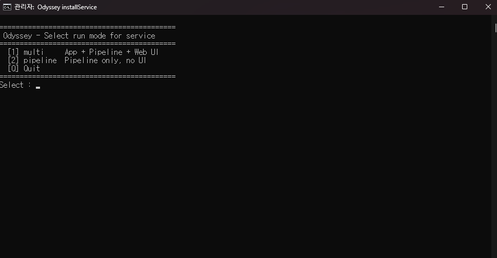

# 4. 실행 / 정지

배포 패키지에는 사전 빌드된 thin jar(<mark style="color:red;">`odyssey-<버전>.jar`</mark>)와 외부 라이브러리(**`lib/`**)가 포함되어 있어, 별도 빌드 없이 바로 기동할 수 있습니다. 실행에는 Java 21 이상이 필요합니다. (패키지에 **`jre/`** 가 있으면 번들 JRE, 없으면 시스템 Java 사용)

## 1. Linux <a href="#linux" id="linux"></a>

Odyssey 설치 폴더에서 다음 명령을 실행합니다.

<mark style="color:red;">`start.sh`</mark> 는 자동으로 적절한 Java 를 선택하고(**`jre/`** 동봉 시 번들 JRE, 미동봉 시 시스템 Java 21) 외부 **`lib/`** 를 classpath 와일드카드로 인식합니다.

— 운영자가 별도로 설정할 것은 없습니다. ([2-5. jre 폴더 — 번들 JRE](2.-package/2-5.-jre-jre.md) 참고)

```bash
# 시작
./start.sh

# 정지 (graceful, 최대 90초 대기)
./stop.sh

# 강제 정지
./stop.sh force
```


첫 실행 전 한 번만 실행 비트 복원: <mark style="color:green;">**`chmod +x start.sh stop.sh`**</mark> (번들 JRE 동봉 시 `chmod -R +x jre/bin` 도 함께 실행)


### 정지할 때의 동작 <a href="#stop-behavior" id="stop-behavior"></a>

* <mark style="color:red;">`./stop.sh`</mark> 는 종료 신호를 보낸 뒤 프로세스가 끝날 때까지 **최대 90초** 기다립니다. 90초 안에 끝나지 않으면 강제 종료합니다.
* Odyssey 는 종료 신호를 받으면 새 메시지 수집을 멈추고, 처리 중인 메시지가 끝나기를 **최대 60초** 기다립니다. 남은 건수가 5초 동안 줄지 않으면 더 기다리지 않습니다.
* 그 뒤에도 큐에 남아 발송되지 않은 메시지는 **수집 전 상태**(**`STATUS`** 1 · 4 · 7 → 0 · 3 · 6)로 되돌립니다. 되돌린 메시지는 다음 기동 때(이중화 환경에서는 남은 노드가) 다시 수집해 발송합니다.
* DB 오류로 되돌리지 못한 메시지는 설치 폴더의 **`recovery/`** 에 SQL 파일로 남기고, 다음 기동 때 자동으로 실행합니다. **`recovery/`** 폴더의 파일을 지우지 마세요.
* KT 직접 연동 : 정지 전에 KT 가 접수한 메시지는 실패로 기록하지 않습니다. 재기동 뒤에 도착한 배달 결과를 해당 메시지에 반영하며, 이를 위해 기동 후 5분 동안은 만료 처리를 하지 않습니다.
* pid 파일에 적힌 PID 가 Odyssey 프로세스가 아니면 pid 파일만 정리하고 끝납니다. Odyssey 를 다른 계정으로 실행했다면 오류를 안내하므로, 실행한 계정이나 `sudo` 로 다시 실행하세요.


**강제 종료 · 장애 시 주의**

강제 정지(`./stop.sh force`), 프로세스 강제 종료, 서버 장애로 Odyssey 가 내려가면 위의 되돌리기가 실행되지 않습니다. 이때 수집만 되었거나 발송 중이던 메시지는 **`STATUS`** 1(2차 4, 3차 7)로 남고, 예약 시각 기준 24시간이 지나면 실패(결과코드 `16`, `time out fail`)로 기록됩니다. 자동으로 다시 발송하지 않습니다.

이 메시지 가운데에는 **실제로는 수신자에게 발송된 메시지**가 있을 수 있습니다. 다시 보내면 수신자가 두 번 받게 되므로, 재발송 전에 수신 여부를 확인하세요.

정상 정지(`./stop.sh`)에서도 종료 시점에 발송 처리 중이던 일부 메시지는 같은 상태로 남을 수 있습니다.


## 2. Windows <a href="#windows" id="windows"></a>

Windows 패키지는 두 가지 운영 모드를 제공합니다.

— **수동 실행** (테스트/임시) 과 **Windows 서비스 등록** (24/7 운영, 권장).

### 수동 실행

cmd 또는 탐색기 더블클릭으로 실행. 사용자 로그인 세션에 묶여 있어 **로그아웃 시 종료**됩니다.

```cmd
start.bat                    
stop.bat                     
```

### Windows 서비스 등록 (24/7 운영)

<mark style="color:red;">`installService.bat`</mark> 더블클릭(또는 cmd 실행) → UAC 권한 자동 요청 → 메뉴에서 모드 선택 → **서비스 등록 + 시작 한 번에 처리** (부팅 시 자동 시작 + 죽으면 자동 재시작 + **사용자 로그아웃 무관 동작**)

<figure><figcaption><p>그림 09. installService.bat 실행</p></figcaption></figure>

```cmd
installService.bat           :: 서비스 자동 등록 + 실행
unInstallService.bat         :: 서비스 정지 + 등록 해제
```

### 등록 후 운영

```cmd
sc query Odyssey             :: 상태 확인
net stop Odyssey             :: 정지
net start Odyssey            :: 시작
```

또는 <mark style="color:red;">`services.msc`</mark> 에서 "Odyssey" 항목 우클릭으로 GUI 조작 가능.


수동 모드와 서비스 모드를 **동시에 실행하지 마세요**. (포트/DB 락 충돌)

한 모드만 골라 운영하세요. 설치 경로는 한글/공백 없는 영문(예: **`C:\Odyssey\`**)을 권장합니다.


***

## 3. 정상 기동 확인 <a href="#undefined" id="undefined"></a>

`logs/live/`<mark style="color:red;">**`system.log`**</mark>(또는 `logs/`<mark style="color:red;">**`odyssey-pipeline.out`**</mark>)에 다음과 유사한 메시지가 출력됩니다.

```
Java: ./jre/bin/java (bundled JRE (./jre))

INFO  [main] c.mono.pipeline.PipelineApplication - Starting PipelineApplication using Java 21.0.11 with PID 17104 (C:\...\odyssey...  started by mono in C:\...\odyssey...)
INFO  [main] c.mono.pipeline.PipelineApplication - No active profile set, falling back to 1 default profile: "default"
INFO  [main] o.s.b.w.e.tomcat.TomcatWebServer - Tomcat initialized with port **** (http)
INFO  [main] o.a.coyote.http11.Http11NioProtocol - Initializing ProtocolHandler ["http-nio-****"]
INFO  [main] o.a.catalina.core.StandardService - Starting service [Tomcat]
INFO  [main] o.a.catalina.core.StandardEngine - Starting Servlet engine: [Apache Tomcat/10.1.46]
INFO  [main] o.a.c.c.C.[Tomcat].[localhost].[/] - Initializing Spring embedded WebApplicationContext
INFO  [main] o.s.b.w.s.c.ServletWebServerApplicationContext - Root WebApplicationContext: initialization completed in 2789 ms
INFO  [main] c.m.pipeline.config.TenantDBConfig - Detected DBMS type : mysql
INFO  [main] com.zaxxer.hikari.HikariDataSource - COLLECT-HikariCP - Starting...
INFO  [main] com.zaxxer.hikari.pool.HikariPool - COLLECT-HikariCP - Added connection com.mysql.cj.jdbc.ConnectionImpl@********
INFO  [main] com.zaxxer.hikari.HikariDataSource - COLLECT-HikariCP - Start completed.
...
INFO  [main] c.m.p.init.PoseidonStartNotifier - Poseidon integration disabled (poseidon.url not configured) — skipping start notification, heartbeat, shutdown signal
```


<mark style="color:$primary;">**시작 로그 핵심**</mark>

* `Starting PipelineApplication using Java ...` - Java 버전 및 종류 확인 ([2-5. jre 폴더 — 번들 JRE](2.-package/2-5.-jre-jre.md) 참고)
* `Detected DBMS type : ...` - 외부 매퍼 정상 로드 ([2-2. config/mapper 폴더 — 매퍼 외부화](2.-package/2-2.-config-mapper.md) 참고)
* `Poseidon integration disabled` - Poseidon 미연동 환경에서만, 정상 ([16. Poseidon 모니터링 연동](../part-2./16.-poseidon/) 참고)


***

## 4. 버전 업그레이드 <a href="#upgrade" id="upgrade"></a>

이미 설치된 Odyssey 를 새 버전으로 올릴 때의 절차입니다. 기존 **`config/application.yml`** 등 고객사 설정은 그대로 유지합니다.

1. **Odyssey 정지** — `./stop.sh` (Windows 서비스는 `net stop Odyssey`)
2. **백업** — 기존 <mark style="color:red;">`odyssey-<기존버전>.jar`</mark> 와 **`config/`** 폴더를 설치 폴더 밖으로 복사해 둡니다.
3. **JAR 교체** — 새 <mark style="color:red;">`odyssey-<새버전>.jar`</mark> 를 설치 폴더에 넣고, **기존 버전의 JAR 는 설치 폴더에서 치웁니다.** [버전별 교체 대상](4.-start-stop.md#replace-files) 의 비고에 적힌 파일도 함께 교체합니다.
4. **매퍼 교체** — **`config/mapper/{DBMS}/`** 의 XML 을 새 패키지의 파일로 교체합니다.
5. **로그 테이블 기본 키 삭제** — 1.0.9 이하에서 1.0.10 이상으로 올리는 경우, [19. 테이블 레이아웃](../part-3./19.-mysql/#log-table-pk) 의 SQL 을 실행합니다.
6. **Odyssey 시작** — `./start.sh` (Windows 서비스는 `net start Odyssey`) 후 [3. 정상 기동 확인](4.-start-stop.md#undefined) 의 로그를 확인합니다.


**기존 버전의 JAR 를 설치 폴더에 남겨 두지 마세요.** 설치 폴더에 <mark style="color:red;">`odyssey-*.jar`</mark> 가 2개 이상 있으면 시작 스크립트가 **이전 버전 JAR 로 기동할 수 있습니다.** 기동 후 Web UI 상단의 버전 표시로 버전을 확인하세요.



**매퍼 XML 은 JAR 와 함께 교체해야 합니다.** Odyssey 는 외부 **`config/mapper/{DBMS}/`** 의 매퍼를 사용하므로, JAR 만 교체하면 이전 버전의 쿼리가 그대로 동작합니다. 매퍼를 직접 수정해 사용 중이라면 교체 후 수정 내용을 다시 반영하세요.


### 버전별 교체 대상 <a href="#replace-files" id="replace-files"></a>

| 버전     | JAR 외에 교체할 파일 (`config/mapper/{DBMS}/`) | 비고                                                                                                    |
| ------ | --------------------------------------- | ----------------------------------------------------------------------------------------------------- |
| 1.0.8  | `BatchUpdateMapper.xml`                 | GSMS 발송 결과 반영 쿼리 수정. 배포 패키지에 **`config/senderId.yml`** 포함 (GSMS 사용 시 필요)                                                    |
| 1.0.10 | `BatchUpdateMapper.xml`, `CollectClaimMapper.xml`, `FetchMapper.xml`, `SelectMapper.xml`, `table.xml` | 로그 테이블 이관 방식 변경 (**`STATUS 9`**, 로그 테이블 **`MSG_ID`** 기본 키 제거), 이중화 수집 분배와 장애 전환, KT 재기동 결과 반영. 교체하지 않으면 이관 실패 처리 중 오류가 발생합니다. **`lib/`** 와 **`libs/`** 의 `odyssey-ha-1.0.0.jar` 는 지우고 `odyssey-ha-1.1.7.jar` 를 넣습니다. `stop.sh` 도 교체합니다 |
