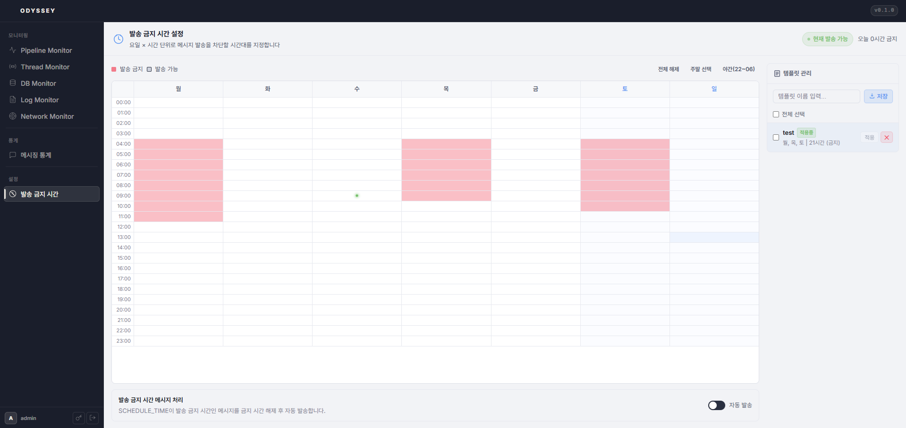

# 20-2. 발송 금지 시간

요일 별·시간대 별 발송 차단 스케줄을 시각적으로 설정합니다.

* **시간 그리드**: 7일(월\~일) × 24시간 격자를 **드래그**하여 차단 시간대를 선택합니다.
* **우클릭**: 연결된 차단 블록을 한번에 해제합니다.
* **템플릿**: 자주 사용하는 차단 패턴을 저장 / 불러오기 / 삭제 할 수 있습니다.

<figure><figcaption>
그림 15. 발송 금지 시간 설정 — 요일×시간 그리드 + 템플릿 관리
</figcaption></figure>


설정 값은 <mark style="color:red;">**`application.yml`**</mark> 이 아닌 **`PAUSE_INFO`** 테이블에 저장됩니다. 광고성 메시지는 정보통신망법에 따라 야간(21:00\~08:00) 발송이 금지되어 있으므로 해당 시간대를 차단 설정해야 합니다.


### 금지 시간 동안의 동작 

금지 시간에는 Odyssey 가 발송을 막습니다. 화면에서 고른 처리 방식에 따라 다음과 같이 동작합니다.

| 처리 방식            | 동작                                                                                                                  |
| ---------------- | ------------------------------------------------------------------------------------------------------------------- |
| 즉시 실패 처리         | 금지 시간에 들어온 메시지를 발송하지 않고 실패로 기록합니다. (**`RESULT`** `-1`, **`RESULT_DESC`** `pause time fail`)                 |
| 금지 시간 해제 후 자동 발송 | 금지 시간 동안 메시지를 수집하지 않습니다. 메시지는 대기 상태(**`STATUS`** 0 · 3 · 6)로 남았다가 금지 시간이 끝나면 발송됩니다. |


* 금지 시간은 **메시지 종류를 구분하지 않고 모든 메시지에 적용**됩니다. 인증번호처럼 야간에도 보내야 하는 메시지를 같은 Odyssey 로 발송한다면 함께 막힙니다.
* 설정 변경은 최대 1분 안에 반영됩니다.
* "금지 시간 해제 후 자동 발송" 방식에서, 금지 시간이 시작되기 전에 이미 수집된 메시지는 그대로 발송됩니다.

